# Rock 'n' Roller III: World Tour

Rock, the boulder, is taking the band on a world tour. Ten cities, ten
shows, and every night the venue is on the far side of town: roll through
London, Paris, Venice, the Alps, Spain, Egypt, Tokyo, Rio, Sydney and New
York, and run into the annoying people you find abroad (tourists, mimes,
gondoliers, matadors, salarymen, surfers, the odd corgi) fast enough to
smash them. Every stop has its own light, its own weather, its own band and
its own way of dropping things on you on the beat. One of them is a
mountain.

The third [Rock 'n' Roller](https://github.com/h1ddenpr0cess20/rocknroller),
on the engine of [Rock 'n' Roller II: Hollywood Nights](https://github.com/h1ddenpr0cess20/rocknroller-ii)
(the renderer, physics, tiled venues and camera), with the stops, cast,
props, machinery, score and rules all redone for the road.

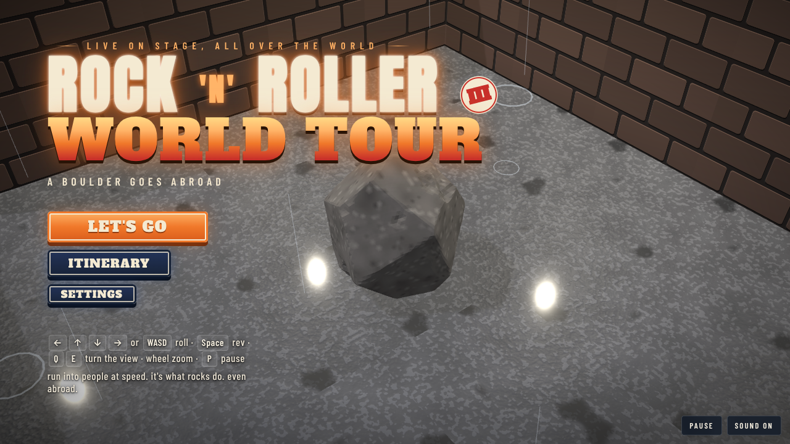

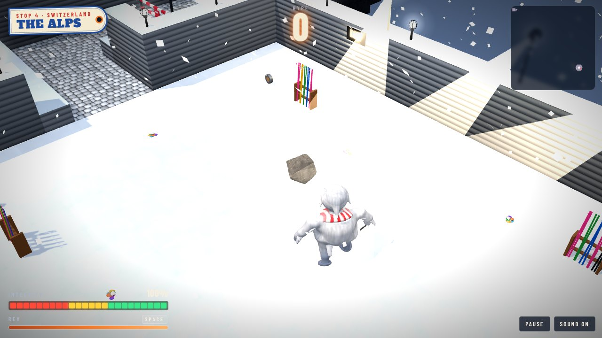

## Run

```sh
git clone https://github.com/h1ddenpr0cess20/rocknroller-iii
cd rocknroller-iii
npm install
npm run dev               # → http://localhost:5173
```

It is a static page: no server, no keys. `npm run build` puts it in `dist/`,
which runs from any folder or path. It uses WebGPU where the browser has it and
WebGL2 otherwise. Node 22.12 or later.

## Play

| | |
|---|---|
| <kbd>←</kbd><kbd>↑</kbd><kbd>↓</kbd><kbd>→</kbd> or <kbd>WASD</kbd> | Roll. The streets run diagonally across the screen, so hold two at once. |
| <kbd>Space</kbd> or <kbd>Shift</kbd> | **Rev**: hold to charge. Harder push and a higher top speed, until it runs dry. |
| Hold the mouse or a finger | Roll toward the pointer. The further it is from Rock, the harder the push. On a touch screen there is a REV button. |
| <kbd>Q</kbd> <kbd>E</kbd>, or drag with the right mouse button | Turn the view. Dragging up and down tilts it. |
| Mouse wheel, or <kbd>+</kbd> <kbd>−</kbd> | Zoom. |
| Two fingers | Pinch to zoom, twist to turn, drag up or down to tilt. |
| <kbd>C</kbd> | Put the view back. |
| <kbd>Enter</kbd> / <kbd>Space</kbd> | Go, and carry on after a stop. |
| Gamepad | Left stick or d-pad rolls; right stick turns and tilts; shoulder buttons zoom; <kbd>A</kbd>, <kbd>X</kbd> or the right trigger revs; <kbd>Start</kbd> pauses. |
| <kbd>P</kbd> / <kbd>Esc</kbd> | A layover (pause). |
| <kbd>M</kbd> | Sound on or off. |

### Speed is everything

How hard Rock hits someone depends on how fast he was going, in tiles a
second. Everybody has a **toughness**, the speed it takes to smash them in one
go, and a **power**, how much it hurts to bounce off them.

| Speed | | What happens |
|---|---|---|
| 1.7 times what it takes (13 at the least) | **Flattened** | Gone, with double the hype. |
| At least their toughness | **Smash** | Gone, and it costs Rock nothing. |
| Over half their toughness | **Bonk** | You both bounce. It costs Rock some of their power, less the closer you were to a smash. |
| Under that | **Tap** | It hurts, all of their power, and they don't move. |

The furniture is fair game too: phone boxes, café tables, market stalls,
vending machines, barbecues and orange trees all go over if Rock comes at
them fast enough (the bigger, the faster), for a little hype. Someone who
isn't smashed is still worn down, and a doorman you can't hit hard enough can
be hit twice. The three bosses take a good deal more than that.

### Staying in one piece

- **Integrity** starts at 100. Knocks, live wires, things dropped on the beat, the floor bursting, falls take it away; **gaffer tape** puts 25 back.
- At nothing, Rock shatters, unless he picked up a **lighter**: hold it up for an **encore**, and Rock gets back up on half.
- **Hype** is the score. Guitar **picks** are worth a little, a **suitcase** of them more; smashing people is worth more than that, and smashing them one after another builds a combo (up to ×5) that multiplies each one.

### Stars

Each stop gives up to three:

1. **Make the show**: get to the stage door.
2. **Crowd-pleaser**: smash three in four of the people in the way.
3. **Souvenir hunter**: find all three **snow globes**.

Your stars, best hype and best time for each stop are kept in the browser's
local storage (`rocknroller3.v1`), and each stop opens when you finish the one
before. The game plays the same with storage blocked.

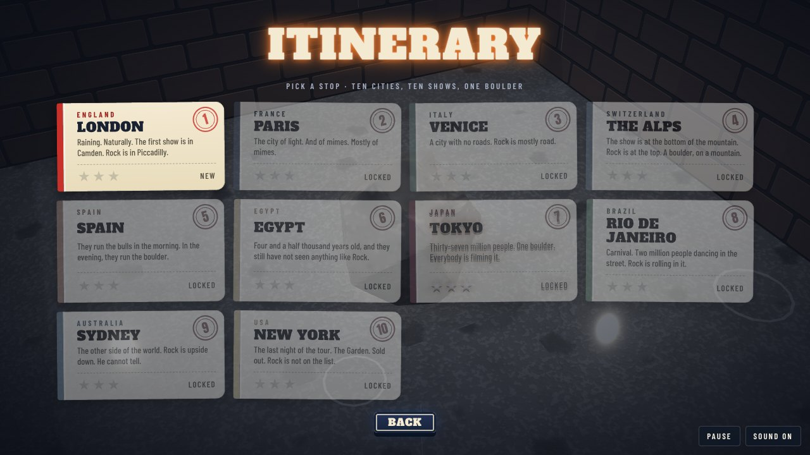

### What is in the way

- **Passport control**: a barrier across the way on. Find the **passport** somewhere on the same stop to lift it.
- **Breakaways**: hoardings, curtains, panes of glass, plasterboard, a wall of crates or of stone, a mirror. Run at one fast enough and it gives way. Behind them are usually snow globes.
- **Drops**, coming down on the beat, a different thing in every country: London's phone boxes, the pianos they keep moving up to the flats in Paris, Venice's window boxes, snowballs off the Alps, Spain's church bells, Egypt's quarry blocks, Tokyo's vending machines, Rio's surdo drums, Sydney's crates off the wharf crane, the speaker stacks in New York. Wait for the moment they go up.
- **The floor goes up** on the beat: snow cannons, sand spouts, the fountains of the palace gardens, the steam off Tokyo's ramen stalls, festival fireworks, barbecues.
- **Live wires** zap whatever rolls onto them; water does the same.
- **Rides**: a Thames ferry, the last Métro, a bateau-mouche, a gondola, the cable car, a raft on the river at Ronda, a felucca on the Nile, the bullet train, a carnival float, Sydney's harbour ferries, and in New York's arena the crowd's hands. Get on while they wait.
- **Ice**: in the Alps' ice cave and on the frozen lake, Rock can hardly push and hardly stop.
- **Sticky floors** (the tomatoes in Spain, quicksand in Egypt) slow Rock; **the crowd and the rip** carry him; **bumpers** (bollards, snowmen, palms, mooring poles, amphorae, stone lanterns) throw him back.

## The tour

Every stop is laid out its own way, lit its own way, and played in its own
music.

| | Stop | The way through |
|---|---|---|
| 1 | **London** | In the rain, of course. Off the tour bus along a street of phone boxes, a square where a guardsman marches and the pigeons own the place, down into the Underground (mind the gap) where phone boxes come down the escalator shaft, past the palace railings and the corgis, a ferry over the Thames, and Camden. Teaches the lot. Britpop, and Rock goes terribly British about it. |
| 2 | **Paris** | Down from Montmartre through the cafés and the easels, the last Métro over a flooded line, the booksellers along the Seine, a bateau-mouche to the island, the palace fountains on the beat, a gallery under the pianos being moved upstairs, and the cabaret. A musette: accordion, la pompe, swing. |
| 3 | **Venice** | Down the bell tower's ramp, across the square under the festival fireworks, along the Grand Canal under the window boxes, a masked ball in a palazzo, a gondola across the lagoon to the glassworks on Murano. A tarantella, mandolins in tremolo. |
| 4 | **The Alps** | The mountain. Off the summit cross, along the knife-edge ridge with the ibex, down the piste among the skiers and the snow cannons, the avalanche gully, the hut and its St Bernard, the cable car over the gorge, the ice cave, the glacier's ladders, the bobsleigh run, and the village square, where **the Yeti**, on a ski holiday, lunges for whatever comes down the mountain. Snow the whole way down. A polka and an alphorn. |
| 5 | **Spain** | A fiesta. Down through the orange trees, along the street where they run the bulls in the morning and throw tomatoes in the afternoon, the flamenco in the tablao, the bull who should not be in the stables, the church bells coming down in the cellars, a raft at the foot of the gorge, and the bullring. A rumba, rasgueado and palmas, a trumpet calling. |
| 6 | **Egypt** | In a sandstorm. The bazaar and its sellers, a felucca across the Nile, the quarry where the blocks come down off the cliff as they did for the builders, the archaeologists' tent, the dunes and their quicksand and the Mummy, and down inside the pyramid to the king's chamber and the treasury across the pit. The darbuka's maqsum, strings, an oud. |
| 7 | **Tokyo** | Neon, and the cherry blossom coming down through it. The great crossing, the ramen stalls steaming on the beat, a karaoke box (the tour's one mirror ball), an alley of tiny bars where the vending machines come off the truck, the robot restaurant, the bullet train out to where Fuji is, and the sumo stable, where **the Yokozuna** stamps and the ring throws you out of it. City pop over taiko, a koto on top. |
| 8 | **Rio** | Carnival. Down the favela's steps under the live wires, the samba school's hall where the drums rehearse, the Sambadrome with the crowd surging to the edge, the shed where the floats are built, a float over the gap, and Copacabana. A samba school: the surdos, a cavaquinho, the whistle. |
| 9 | **Sydney** | Off the top of the Harbour Bridge, across Circular Quay on the ferries, the barbecues in the Rocks flaring on the beat, Bondi and its rip, the surf club, the rock pool and its croc. Surf rock at a gallop, and a didgeridoo. |
| 10 | **New York** | The last night. Times Square under the searchlights, Broadway between the velvet ropes, the arena's concourse, down the stands under the speaker stacks, across the pit on the crowd's hands, and onto the stage, where **the Superfan**, who has been to every show and has Rock's face on his arm, moves on the beat, like Rock taught him. The anthem, with the brass out. |

| | |
|---|---|
| 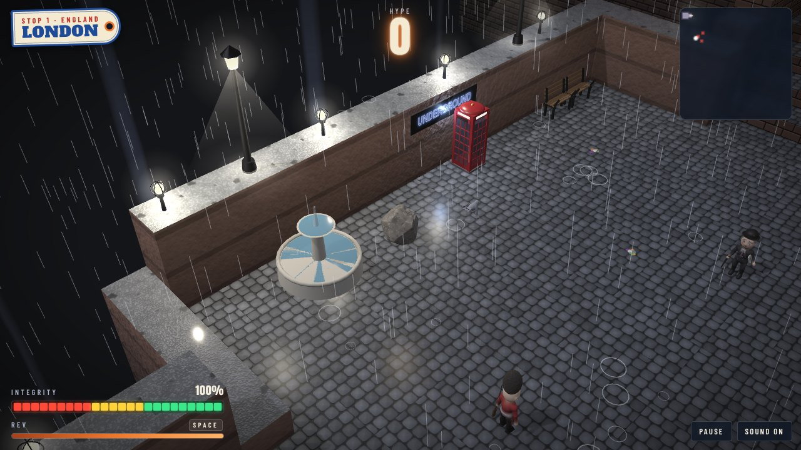 | 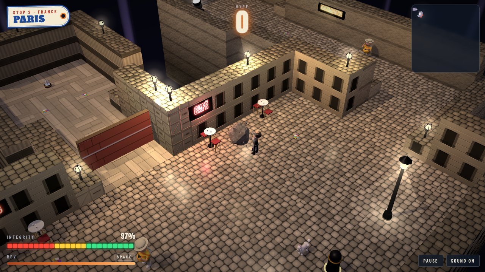 |
| 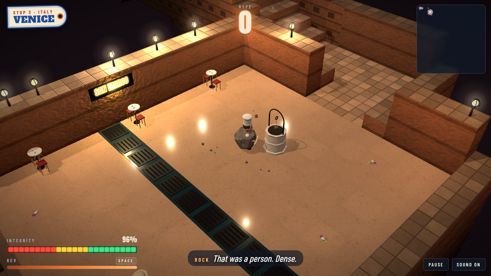 |  |
| 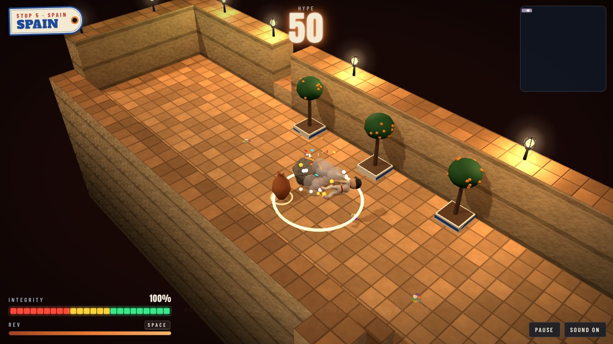 | 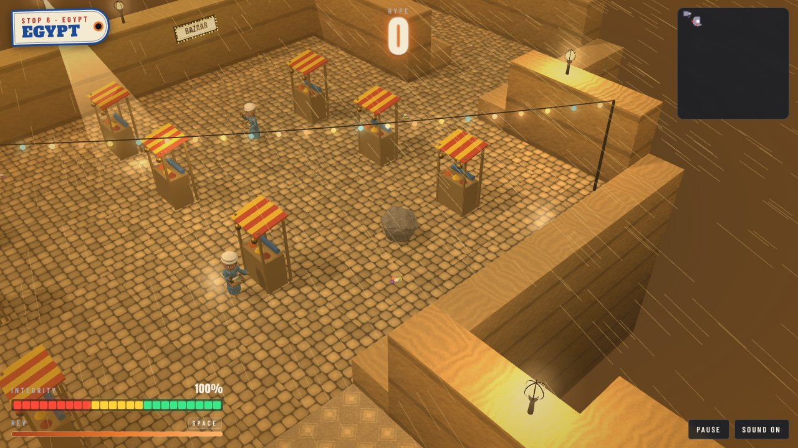 |
| 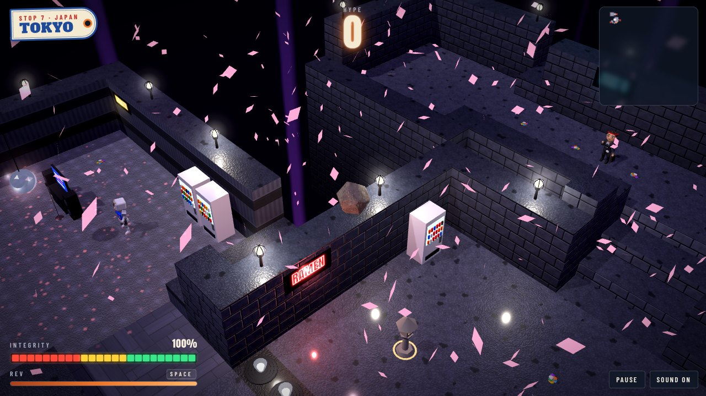 | 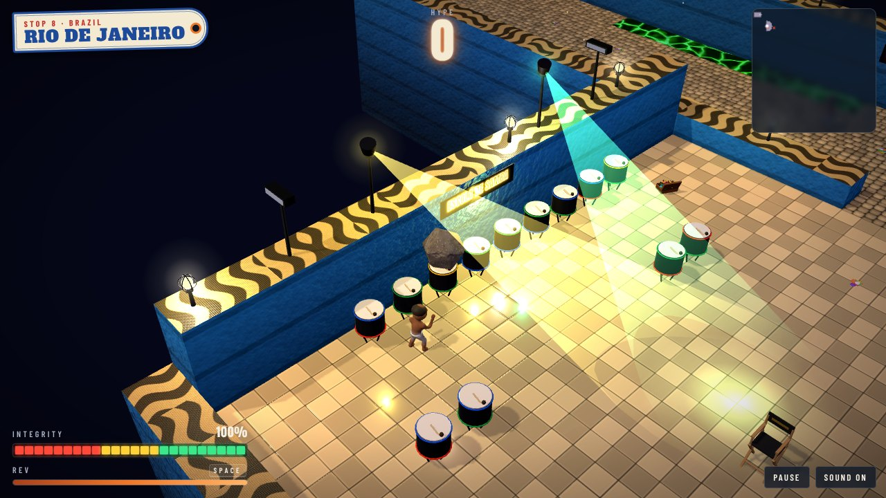 |
| 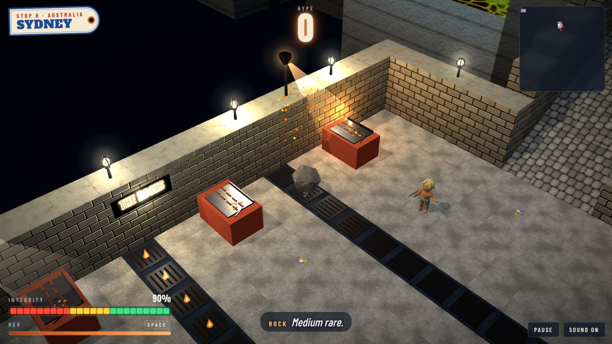 | 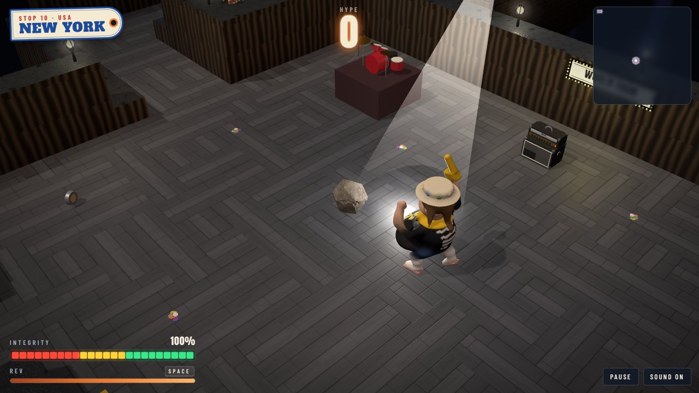 |

## The light and the weather

Each stop is graded in its own light (`look.grade`): fog for London, dusk
for Paris and Venice, the glare off the snow in the Alps, warm for Spain and
Egypt, neon for Tokyo, tropical for Rio and Sydney. Its sky is painted
behind it, a horizon of hills, a city, mountain peaks, dunes, the sea or
Fuji (`look.horizon`), and the weather falls on it: rain in London,
splashing on the cobbles, snow in the Alps, sand blowing in Egypt and
cherry blossom in Tokyo.

The rig (`src/lightshow.js`) keeps the beat of the music: pars, spots,
strobes, lasers, neon signs, chandeliers, festoons, searchlights sweeping
the sky, marquees of bulbs and street lamps. Strobes and lightning never
flash more than three times in any second, and **Settings → Flashing
lights** turns them, and the flashbulbs, down to a glow.

## The music

Played live in Web Audio (`src/music.js`), with no audio files: a theme for
every country, each with its own drums, bass line, rhythm part and lead. The
main title is a stadium anthem, the guitars wide open (it comes back for New
York with the brass out). Britpop for London; a musette with the accordion
out front for Paris; a tarantella of mandolins for Venice; a polka and an
alphorn in the Alps; a rumba, rasgueado and palmas, for Spain; the
darbuka's maqsum and an oud for Egypt; city pop over taiko, with a koto,
for Tokyo; a samba school for Rio; surf rock and a didgeridoo for Sydney.
The beat clock drives the hazards and the lights.

## The cast

Sculpted in code (`src/models/cast/`) and baked in background workers while
the page loads. People for every stop: a City Gent with his brolly and The
Times, a bobby, a guardsman, a Camden punk; a mime in his box, a pavement
artist, a waiter with his tray in the air, a cyclist on his bicycle; a
gondolier, a Carnival mask, a pizzaiolo spinning the dough, a nonna with
her spoon; skiers, snowboarders and a yodeler; a matador, a flamenco dancer
and a bull runner; a souvenir seller and an archaeologist; a salaryman at
karaoke, a cosplayer, a sumo apprentice and a theme-park ninja; a samba
dancer, a capoeirista, a beach footballer and a beach vendor; a surfer and
a surf lifesaver; a cab driver and a hot dog vendor. And the ones who
follow the tour everywhere: tourists, influencers, fans, paparazzi,
security, doormen and camera drones.

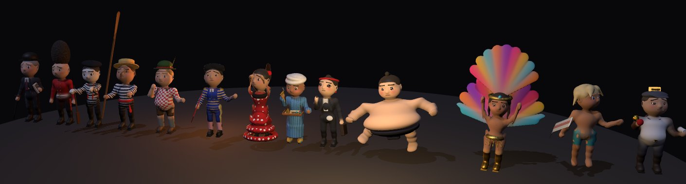

The animals share a skeleton (`quadruped.js`): a corgi, a poodle in the
full continental clip, a St Bernard with its cask, an ibex, a fighting
bull, a camel, a saltwater croc and a subway rat with a slice of pizza
bigger than itself; and on their own, a boxing kangaroo, a scarab with its
ball, the pigeons and a macaw.

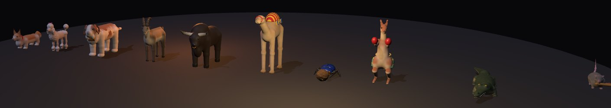

And three bosses, each fought differently: **the Yeti**, who lunges and then
has to get his breath back; **the Yokozuna**, who stamps so the floor throws
Rock back; and **the Superfan**, who moves only on the beat.

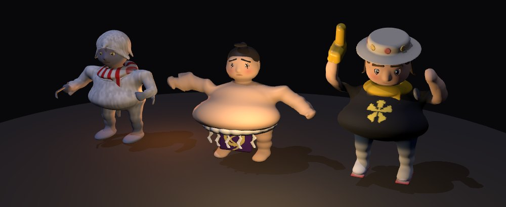

The furniture of the places is built from plain shapes in `src/sights.js`:
red phone boxes, park benches, a fountain, café tables, the bouquinistes'
boxes, easels, a Venetian wellhead, candelabra, the summit cross, a tiled
stove, ski racks, orange trees, market stalls, cut stone, sarcophagi,
vending machines, karaoke, taiko and samba drums, flagpoles, barbecues,
beach umbrellas, surf racks and lockers.

The page itself is a stack of old travel posters: luggage labels for the
itinerary and the stop you are on, postcards with the airmail stripes for
the review, a postmark for the III.

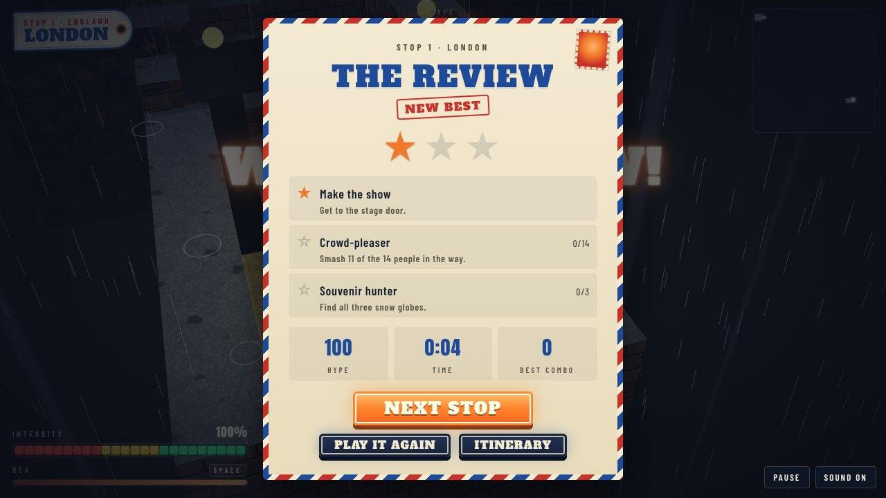

## Develop

```sh
npm run dev       # the game, with hot reload
npm run build     # a static build in dist/
npm test          # node's test runner
npm run lint
```

The tests cover the rules (smashing, hype, integrity, the encore, stars,
storage), the light rig and the strobe limit, the music, the physics and
camera, and every stop: each one has to be finished start to finish, with
all three snow globes, by an autopilot (`test/helpers/autopilot.js`) that
plans a route, waits out the drops and the floor going up, takes a run-up
at the breakaways, fetches the passports and duels the bosses. Every pickup
has to be somewhere Rock can reach and out of the hazards; every sign has
to hang on a wall the width of it; every prop has to be built, fit its
footprint and face open floor; everyone in the way has to be sculpted.

Other things in the box:

```sh
node scripts/map.js 4            # a stop as text (they count from 1); --overlaps shows two pieces dug over each other
node scripts/drive.js 4          # put the autopilot through a stop and say how it went
node scripts/bake.js             # bake every model and say what came out
node scripts/reel.js [name]      # film the vertical gameplay reels into reels/ (the autopilot plays; needs ffmpeg and a Chromium)
```

`models.html` is a turntable for the cast (`?m=yeti,yokozuna,superfan`, and
`&clip=attack&time=0&t=0.4` for a still of a moment in a clip), and in the
browser console `rocknroller.debug.venue(i)` jumps to a stop and
`teleport(x, z)` puts Rock somewhere on it.

## Credits

Rock is [Rock](https://github.com/h1ddenpr0cess20/rock)'s boulder. The engine
is [Rock 'n' Roller](https://github.com/h1ddenpr0cess20/rocknroller)'s, from
[dungeon-roller](https://github.com/h1ddenpr0cess20/dungeon-roller), by way
of [Rock 'n' Roller II](https://github.com/h1ddenpr0cess20/rocknroller-ii).
Type is Alfa Slab One, Anton and Barlow Condensed, from
[Fontsource](https://fontsource.org). See also
[other games](docs/other-games.md).
